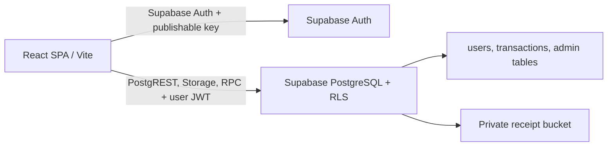

# CatatUang

CatatUang adalah aplikasi web pencatatan keuangan pribadi. Pengguna dapat menyimpan pemasukan dan pengeluaran, melihat ringkasan saldo, serta mengelola akun. Spesifikasi ini dirangkum dari source code, konfigurasi, migrasi SQL, dan test di repository ini; bukan klaim bahwa deployment production atau database remote sudah diperiksa.

## Status fitur

Status berarti implementasi yang ditemukan di repository, bukan jaminan seluruh konfigurasi layanan production sudah tersedia.

| Fitur | Status | Catatan berdasarkan kode |
| --- | --- | --- |
| Registrasi, login, logout, pemulihan dan reset password | Sudah diimplementasikan | Kredensial ditangani Supabase Auth; pemulihan password memakai email Supabase. Email/SMTP production harus dikonfigurasi di Supabase. |
| Session pengguna | Sudah diimplementasikan | Session dikelola Supabase Auth di browser menggunakan Supabase JS. |
| Dashboard saldo dan ringkasan | Sudah diimplementasikan | Saldo awal, pemasukan, pengeluaran, hitungan transaksi. |
| Tambah pemasukan dan pengeluaran | Sudah diimplementasikan | Data transaksi disimpan melalui Supabase API. |
| Kategori transaksi | Sudah diimplementasikan | Kategori dibatasi dan divalidasi di backend. |
| Cari, filter, pagination, dan detail transaksi | Sudah diimplementasikan | Parameter query didukung oleh endpoint transaksi. |
| Ubah/hapus transaksi | Sebagian | Data inti transaksi tidak dapat diedit setelah dibuat; hapus lalu buat ulang. Metadata bukti dapat diperbarui. Penghapusan tersedia. |
| Foto bukti transaksi | Sebagian | Implementasi ada, tetapi migrasi receipt dan bucket Storage harus diterapkan agar fitur siap digunakan. |
| Ekspor laporan transaksi | Sudah diimplementasikan | Ekspor CSV oleh UI; endpoint admin juga menyediakan CSV metrik agregat. |
| Anggaran kategori, target tabungan, pengeluaran 6 bulan | Sebagian | Alat UI tersedia. Anggaran, target dan data jadwal disimpan di `localStorage`, bukan sebagai tabel sinkronisasi server. |
| Transaksi rutin dan pengingat | Sebagian | Ada UI/penjadwalan lokal. Tidak ditemukan worker/server scheduler yang otomatis membuat transaksi rutin atau mengirim push/email reminder. |
| Input transaksi dengan bahasa alami | Sebagian | Parser berjalan lokal di browser; hasilnya perlu diperiksa sebelum disimpan. |
| Pengaturan profil dan saldo awal | Sudah diimplementasikan | Nama dan saldo awal dapat diperbarui. |
| Ubah password dan hapus akun | Sudah diimplementasikan | Menggunakan Supabase Auth/RPC dan mengakhiri session. |
| Panel admin | Sebagian | UI memanggil RPC Supabase dengan JWT pengguna; perlu migrasi admin/direct-client dan pemberian role pada `public.admin_users`. |
| Pengumuman dan mode pemeliharaan | Sebagian | Dikelola panel admin melalui RPC; tampilan status publik perlu migration direct-client. |
| Retensi otomatis transaksi lama | Belum tersedia di deployment statis | Endpoint cron Express lama tidak dijalankan oleh deployment Vercel statis. |
| Aplikasi native/mobile, pembayaran, sinkronisasi multi-device untuk alat `localStorage` | Belum ada / tidak ditemukan | Tidak ditemukan implementasi dalam repository yang diperiksa. |

## Teknologi

Versi di bawah adalah rentang versi yang tercantum dalam `package.json`, bukan versi yang dipastikan sedang aktif di Vercel.

| Lapisan | Teknologi |
| --- | --- |
| Bahasa | TypeScript `^7.0.2`, JavaScript ESM |
| Frontend | React `^19.0.1`, React Router `^7.18.4`, Vite `^8.3.0`, Tailwind CSS `^4.3.3`, `@tailwindcss/vite` `^4.3.3`, `@vitejs/plugin-react` `^6.1.1`, Lucide React `^0.546.0` |
| API aktif | Supabase Auth, PostgREST, Storage, RPC, Supabase JS `^2.117.2` |
| Backend legacy | Express `^4.21.2`, `express-session` `^1.19.0`, `express-rate-limit` `^8.7.0`, Zod `^4.6.5` |
| PostgreSQL/session store legacy | `pg` `^8.23.0`, `connect-pg-simple` `^10.0.0` |
| Konfigurasi lokal | `dotenv` `^17.2.3` |
| Tooling lokal/build | `tsx` `^4.21.0`, TypeScript; Wrangler `^4.151.1` untuk konfigurasi Cloudflare yang juga ada |
| Database/ORM | PostgreSQL di Supabase; tidak ditemukan ORM. Frontend mengakses data melalui Supabase JS dengan RLS. |
| Email | Tidak ditemukan library email khusus. Email verifikasi/pemulihan diminta melalui Supabase Auth; pengiriman aktual bergantung pada pengaturan email/SMTP project Supabase. |

Paket build dan frontend yang hanya diperlukan untuk build berada di `devDependencies`. Backend production memerlukan dependency dari `dependencies`.

## Struktur repository

```text
.
├── api/
  │   └── index.ts                 # Express adapter legacy
├── database/
│   └── migrations/              # skema awal, receipt, immutable transaction, session store
├── server/
│   ├── app.ts                   # Express app, route AI, middleware, API router
│   ├── api.ts                   # endpoint API, autentikasi, session dan query
│   └── logging.ts               # logger backend yang menyamarkan secret
├── src/
│   ├── auth/                    # provider autentikasi frontend
│   ├── components/              # UI dashboard, transaksi, auth dan alat keuangan
│   ├── pages/                   # halaman admin, password reset, pengaturan
│   ├── services/                # pemanggilan API dan layanan AI frontend
│   ├── server/                  # test API backend
│   ├── types/                   # tipe data keuangan
│   ├── utils/                   # validasi, format, kalkulasi, ekspor dan tests
│   ├── App.tsx                  # route dan susunan aplikasi
│   └── main.tsx                 # entry React
├── supabase/
│   └── migrations/              # migrasi panel admin dan monitoring
├── worker/
│   └── index.ts                 # adaptor Express untuk Cloudflare Worker
├── .env.example                 # contoh nama variabel; tanpa credential
├── index.html                   # shell HTML Vite
├── package.json                 # dependencies dan scripts
├── server.ts                    # entry server lokal/Express
├── vercel.json                  # build, rewrites, dan scheduled cron Vercel
├── vite.config.ts               # konfigurasi Vite
├── wrangler.jsonc               # konfigurasi Cloudflare
└── tsconfig.json                # konfigurasi TypeScript
```

Folder `node_modules/` dan `dist/` adalah hasil instalasi/build, bukan source aplikasi. Ada migrasi di dua lokasi: `database/migrations/` untuk skema aplikasi/session/receipt dan `supabase/migrations/` untuk panel admin/monitoring.

## Arsitektur dan autentikasi



1. Vite membangun frontend statis ke `dist/`; Vercel mengirim SPA dengan fallback route ke `index.html`.
2. Supabase Auth mengelola login dan session browser melalui `@supabase/supabase-js`.
3. Browser menggunakan URL project dan publishable/anon key. Semua akses tabel dan Storage tetap dibatasi oleh RLS dan JWT pengguna.
4. Data finansial tiap akun dibatasi berdasarkan `auth.uid()`. Fungsi admin menggunakan `SECURITY DEFINER` dengan pemeriksaan role `admin_users`; service-role key tidak berada di browser.

Kode Express lama masih ada untuk referensi, tetapi tidak menjadi jalur runtime pada deployment Vercel statis.

## API

Bagian ini mendokumentasikan Express API legacy yang source-nya masih ada di repository. Frontend dan deployment Vercel statis saat ini tidak memanggil endpoint tersebut; semua fungsi aktif menggunakan Supabase client dan RLS.

### Auth, profil, dan transaksi

| Method dan path | Login | Fungsi/request utama | Respons sukses |
| --- | --- | --- | --- |
| `POST /api/auth/register` | Tidak | `{ "name": "Nama", "email": "user@example.com", "password": "...", "confirmPassword": "..." }` | `201 { "needsEmailConfirmation": true/false, "user": ... }` |
| `POST /api/auth/password/forgot` | Tidak | `{ "email": "user@example.com" }` | `202` pesan generik untuk menghindari pengungkapan keberadaan akun |
| `POST /api/auth/password/reset` | Token recovery | `{ "accessToken": "...", "refreshToken": "...", "newPassword": "...", "confirmPassword": "..." }` | `204`; token recovery dibatasi umur oleh aplikasi |
| `POST /api/auth/login` | Tidak | `{ "email": "user@example.com", "password": "..." }` | `{ "user": ... }` dan cookie session |
| `POST /api/auth/logout` | Tidak diwajibkan | Tidak ada body | `204`; session lokal dihancurkan dan cookie dihapus |
| `GET /api/auth/session` | Cookie opsional | Tidak ada body | `{ "user": null }` atau `{ "user": ... }` |
| `GET /api/dashboard-summary` | Ya | Ringkasan akun | `{ "initialBalance": 0, "totalIncome": 0, "totalExpense": 0, "transactionCount": 0, "incomeCount": 0, "expenseCount": 0 }` |
| `GET /api/transactions` | Ya | Filter pencarian, tipe, kategori, tanggal dan pagination | `{ "transactions": [...], "total": 0, "page": 1, "pageSize": ... }` |
| `GET /api/transactions/:id` | Ya | Detail milik pengguna | `{ "transaction": ... }` |
| `POST /api/transactions` | Ya | `{ "date": "YYYY-MM-DD", "amount": 10000, "description": "...", "type": "expense", "category": "Makanan" }` | `201 { "transaction": ... }` |
| `PATCH /api/transactions/:id` | Ya | Update metadata receipt yang didukung | `{ "transaction": ... }`; perubahan nilai inti transaksi ditolak |
| `POST /api/transactions/:id/receipt` | Ya | Upload JPG/PNG/WEBP, maksimum 5 MiB | `201` metadata receipt |
| `GET /api/transactions/:id/receipt-url` | Ya | Minta URL bukti untuk transaksi milik pengguna | Signed URL sementara (1 jam) |
| `DELETE /api/transactions/:id` | Ya | Hapus transaksi milik pengguna dan bukti terkait | `204` |
| `PATCH /api/profile` | Ya | `{ "name": "Nama baru" }` | `{ "user": ... }` |
| `PATCH /api/profile/balance` | Ya | `{ "initialBalance": 100000 }` | `204` |
| `PATCH /api/password` | Ya | Password saat ini, password baru, konfirmasi | `204`; verifikasi password lama dan pencabutan sesi |
| `DELETE /api/account` | Ya | Tidak ada body | `204`; hapus akun melalui RPC Supabase dan akhiri sesi |
| `POST /api/ai/parse-transaction` | Tidak | `{ "input": "makan siang 25 ribu" }` | `{ "success": true, "source": "gemini" atau "fallback", "data": ... }` |

Error API umumnya dikirim sebagai `{ "error": "..." }`. Status aktual bergantung validasi, autentikasi, ketersediaan konfigurasi, dan layanan eksternal.

### Status publik, cron, dan admin

| Method dan path | Login | Fungsi/request utama | Respons/hasil |
| --- | --- | --- | --- |
| `GET /api/public/service-status` | Tidak | Mengambil pengumuman dan maintenance mode | `{ "announcement": ..., "maintenanceMode": ... }`; service-role key diperlukan di server |
| `GET /api/cron/purge-old-transactions` | Header `Authorization: Bearer <CRON_SECRET>`; service-role key juga diperlukan | Hapus maksimal 100 transaksi melewati cutoff retensi dua bulan beserta receipt | `{ "deleted": ..., "cutoffDate": "...", "morePending": ... }` |
| `POST /api/admin/auth/login` | Kredensial admin | `{ "email": "...", "password": "..." }` | `{ "user": ..., "role": ... }` dan session admin |
| `POST /api/admin/login-check` | Admin | Cek session dan role | `{ "authenticated": true, "role": ... }` |
| `GET /api/admin/overview` | Admin | Metrik akun dan transaksi | Ringkasan agregat |
| `GET /api/admin/account-growth` | Admin | Pertumbuhan akun | `{ "points": [{ "day": "...", "accounts": 0 }] }` |
| `GET /api/admin/activity?period=30` | Admin | Aktivitas 7–365 hari | Metrik aktivitas |
| `GET /api/admin/retention` | Admin | Metrik retensi dan error operasional | Ringkasan retensi |
| `GET /api/admin/storage-usage` | Admin | Penggunaan Storage | `{ "objectCount": 0, "totalBytes": 0 }` |
| `GET /api/admin/health` | Admin | Pemeriksaan API, database, Auth, Storage | Status `ok` atau `degraded` |
| `GET /api/admin/users` | Admin | Cari/filter/status/tanggal/sort dan pagination akun | `{ "users": [...], "total": 0, "page": 1, ... }` |
| `POST /api/admin/users/:id/disable` | Admin; hak tulis sesuai role | `{ "reason": "..." }` | `204`; perubahan dicatat di audit |
| `POST /api/admin/users/:id/enable` | Admin; hak tulis sesuai role | `{ "reason": "..." }` | `204`; perubahan dicatat di audit |
| `DELETE /api/admin/users/:id` | Admin; hak tulis sesuai role | `{ "email": "...", "reason": "..." }` | `204`; email harus cocok, akun sendiri tidak dapat dihapus |
| `GET /api/admin/audit-logs` | Admin | Filter dan pagination | `{ "logs": [...], "total": 0, "page": 1, "pageSize": ... }` |
| `GET /api/admin/settings` | Admin | Ambil pengumuman dan maintenance | `{ "announcement": ..., "maintenanceMode": ..., "updatedAt": ... }` |
| `PATCH /api/admin/settings/announcement` | Admin; hak tulis sesuai role | `{ "announcement": "...", "reason": "..." }` | `{ "announcement": ... }` |
| `PATCH /api/admin/settings/maintenance` | Admin; hak tulis sesuai role | `{ "enabled": true, "reason": "..." }` | `{ "enabled": true }` |
| `GET /api/admin/export/metrics?period=30` | Admin | Ekspor metrik agregat untuk periode 7–365 hari | CSV |

Peran `support` tidak diberi hak untuk beberapa operasi tulis; kebijakan per operasi diterapkan oleh middleware/backend. Detail validasi dan field response dapat dilihat pada implementasi route di `server/api.ts`.

Contoh login:

```http
POST /api/auth/login
Content-Type: application/json
Origin: https://app.example

{"email":"user@example.com","password":"<password>"}
```

Contoh respons sukses (field profil dapat mengikuti implementasi):

```http
HTTP/1.1 200 OK
Set-Cookie: catatuang.sid=...; HttpOnly; Secure; SameSite=Lax; Path=/
Content-Type: application/json

{"user":{"id":"<uuid>","name":"Nama","email":"user@example.com"}}
```

Memeriksa session tidak memerlukan body. Tanpa cookie atau session yang valid, API mengembalikan `{ "user": null }`:

```http
GET /api/auth/session
```

```json
{"user":null}
```

Permintaan email pemulihan menggunakan respons generik:

```http
POST /api/auth/password/forgot
Content-Type: application/json
Origin: https://app.example

{"email":"user@example.com"}
```

```json
{"message":"Jika email terdaftar, tautan pemulihan akan segera dikirim."}
```

## Skema database

Skema berikut dirangkum dari SQL migrations yang ada. Tabel platform `auth.users` dan `storage.objects` dikelola Supabase, bukan dibuat aplikasi. Tipe yang ditulis adalah tipe PostgreSQL.

| Tabel | Kolom utama | Relasi/keterangan |
| --- | --- | --- |
| `public.users` | `id uuid` PK; `name text`; `email text` unik/lowercase; `initial_balance numeric(14,0)`; `created_at`, `updated_at timestamptz`; migrasi admin menambah `account_status text` dan `disabled_reason text` | `id` → `auth.users(id)` `ON DELETE CASCADE`; trigger membuat profil saat akun Auth dibuat |
| `public.transactions` | `id uuid` PK; `user_id uuid`; `date date`; `amount numeric(14,0)`; `description text`; `type text`; `category text`; `created_at`, `updated_at timestamptz`; migrasi receipt menambah `receipt_path text`, `receipt_mime text`, `receipt_size integer` | `user_id` → `public.users(id)` `ON DELETE CASCADE`; `type` hanya income/expense; RLS berdasarkan pemilik |
| `public.catatuang_express_sessions` | `sid varchar` PK; `sess json`; `expire timestamp(6)` | Tabel legacy untuk Express; tidak dipakai deployment Vercel statis |
| `public.sessions` | `sid varchar` PK; `sess json`; `expire timestamp(6)` | Tabel legacy dari baseline migration; tidak dipakai frontend Supabase langsung |
| `public.admin_users` | `user_id uuid` PK; `role text`; `created_at timestamptz` | `user_id` → `auth.users(id)` `ON DELETE CASCADE`; role dibatasi `admin`, `support`, `owner` |
| `public.admin_audit_logs` | `id bigint` identity PK; `actor_user_id uuid`; `actor_role text`; `action text`; `target_user_id uuid`; `reason text`; `result text`; `details jsonb`; `created_at timestamptz` | actor → `auth.users(id)` `ON DELETE SET NULL`; target tidak memiliki FK pada migrasi |
| `public.app_settings` | `id boolean` PK; `announcement text`; `maintenance_mode boolean`; `updated_by uuid`; `updated_at timestamptz` | `updated_by` → `auth.users(id)` `ON DELETE SET NULL`; row singleton memakai `id=true` |
| `public.admin_service_errors` | `id bigint` identity PK; `service text`; `route text`; `status_code integer`; `created_at timestamptz` | Telemetri terbatas untuk admin; tidak berisi deskripsi/jumlah transaksi |
| `public.admin_retention_runs` | `id bigint` identity PK; `deleted_count integer`; `cutoff_date date`; `created_at timestamptz` | Ringkasan job retensi |

Kategori tidak dibuat sebagai tabel terpisah; definisi kategori berada di source frontend/backend. Anggaran/target lokal juga tidak memiliki tabel migrasi yang ditemukan. Tidak ditemukan schema ORM.

### Migrasi

File migrasi yang ada:

- `database/migrations/001_finance_auth.sql` — tabel profil/transaksi, trigger profil, RLS/policy, fungsi ringkasan dan hapus akun, tabel session lama.
- `database/migrations/20261015113000_add_express_session_store.sql` — tabel session yang digunakan Express.
- `database/migrations/20261013210100_add_transaction_receipts.sql` — metadata receipt, bucket privat, dan policy Storage.
- `database/migrations/20261013212000_make_transactions_immutable.sql` — trigger yang menolak perubahan data inti transaksi.
- `supabase/migrations/20261013220000_add_admin_panel.sql` — kolom status akun dan tabel/fungsi admin awal.
- `supabase/migrations/20261013230000_restrict_user_status_updates.sql` dan `20261014060000_add_admin_dashboard_aggregates.sql` — hardening dan agregat admin.
- `supabase/migrations/20261016120000_admin_activity_monitoring.sql` — telemetri error dan retensi.
- `supabase/migrations/20261020100000_direct_client_rls.sql` — RLS akun aktif serta RPC admin yang aman dipanggil dengan JWT pengguna.

Periksa keadaan database target sebelum menjalankan migrasi. Baseline tidak boleh dijalankan ulang pada database yang telah berisi aplikasi/data tanpa penilaian migrasi terlebih dahulu. Untuk database baru, jalankan baseline sekali, lalu migrasi receipt/admin dan migrasi direct-client. Migration session-store hanya dibutuhkan oleh Express legacy. Profil dibuat oleh trigger Supabase Auth, dan row awal `app_settings` dibuat oleh migrasi admin.

## Environment variables

`.env.example` menyediakan dua variabel frontend. Karena prefix `VITE_` membuat nilai tersedia di bundle browser, isi hanya URL Supabase dan publishable/anon key. Jangan pernah menaruh service-role atau secret key di variabel `VITE_`.

| Nama | Wajib | Format/contoh non-rahasia |
| --- | --- | --- |
| `VITE_SUPABASE_URL` | Ya | `https://<project-ref>.supabase.co` |
| `VITE_SUPABASE_PUBLISHABLE_KEY` | Ya | `<Supabase publishable key>`; nama lama `VITE_SUPABASE_ANON_KEY` juga diterima |

## Menjalankan lokal

### Prasyarat

- Node.js `20.19+` atau `22.12+` (sesuai dokumentasi/prasyarat repository dan kompatibilitas tooling).
- npm.
- Project Supabase dengan Auth email/password, tabel CatatUang, RLS, dan bucket receipt.

### Setup

```powershell
Copy-Item .env.example .env.local
# Isi hanya variabel lokal yang diperlukan di .env.local
npm install
```

Untuk database baru, terapkan migrasi baseline dan migrasi fitur sesuai urutan pada [bagian migrasi](#migrasi). Untuk project/database yang sudah dipakai, inspeksi tabel dan migration history terlebih dahulu; jangan mengulang baseline secara membabi buta. Jalankan migrasi `20261020100000_direct_client_rls.sql` pada SQL Editor Supabase untuk mengaktifkan RPC dan kebijakan akses browser yang baru.

### Scripts `package.json`

| Script | Fungsi |
| --- | --- |
| `npm run dev` | Menjalankan Vite di `http://localhost:3000` |
| `npm run dev:open` | Windows: menjalankan helper PowerShell dan membuka browser |
| `npm run stop:web` | Menghentikan helper server web Windows |
| `npm run build` | `vite build`, menghasilkan frontend statis di `dist/` |
| `npm start` | Menjalankan preview server untuk build statis |
| `npm run preview` | Menjalankan Vite preview |
| `npm run lint` | `tsc --noEmit` |
| `npm test` | Menjalankan test finance dan API melalui `tsx --test` |
| `npm run cloudflare:dev` | Build lalu `wrangler dev` |
| `npm run cloudflare:deploy` | Build lalu `wrangler deploy` |
| `npm run clean` | Menghapus `dist` dan `server.js` jika ada |

Jalankan `npm run dev` lalu buka `http://localhost:3000`. Untuk helper browser otomatis pada Windows: `npm run dev:open`; hentikan dengan `npm run stop:web`.

## Deploy ke Vercel

`vercel.json` menetapkan:

- Build command: `npm run build`
- Output directory: `dist`
- Fallback route ke `/index.html` untuk React SPA

Tambahkan `VITE_SUPABASE_URL` dan `VITE_SUPABASE_PUBLISHABLE_KEY` di **Project Settings → Environment Variables** untuk Production. Setelah perubahan env atau kode, redeploy agar nilainya masuk ke bundle frontend.

Catatan:

- Pastikan dev dependencies tersedia selama build Vercel karena `vite build` dan plugin Vite berada di `devDependencies`. Jangan konfigurasi install production-only sebelum proses build.
- Pastikan migration RLS CatatUang sudah diterapkan pada project Supabase yang sama dengan URL di Vercel.
- Riwayat project yang diberikan menyebut `ERR_UNSUPPORTED_DIR_IMPORT` dan error native Rolldown binding. Itu adalah riwayat laporan pengguna, bukan bukti bahwa deployment terbaru sudah memperbaiki/masih mengalami error tersebut; repository tidak dapat memverifikasi deployment `keuangan-ioq5.vercel.app`.

## Keamanan dan batasan

- Password tidak disimpan oleh aplikasi; Supabase Auth mengelola kredensial/password.
- Supabase Auth menyimpan session browser; publishable key aman dipublikasikan hanya dengan RLS aktif.
- RLS membatasi profil, transaksi, Storage, serta akses RPC admin berdasarkan `auth.uid()` dan role.
- Zod memvalidasi input; JSON request dibatasi 32 KiB; transaksi memvalidasi tipe, tanggal, jumlah dan kategori.
- Security headers mencakup `X-Content-Type-Options`, `X-Frame-Options`, Referrer Policy, Permissions Policy; production menambah HSTS dan CSP.
- Supabase Auth menerapkan perlindungan autentikasi dan rate limit platform.
- Receipt dibatasi MIME dan ukuran, disimpan di bucket privat dengan policy per UID. Signed URL berlaku sementara.
- Jangan menaruh secret/service-role key pada variabel `VITE_` atau bundle browser.
- Data inti transaksi dibuat immutable setelah insert; ubah dengan hapus dan input ulang.
- `.env`/`.env.local` tidak boleh di-commit. `.env.example` hanya boleh memuat nama dan contoh non-rahasia.

## Masalah diketahui dan hal yang belum dipastikan

- **Runtime Supabase:** login/data langsung dari browser memerlukan migration CatatUang yang sesuai dan RLS aktif pada project yang sama dengan dua variabel Vite.
- **Konfigurasi production:** isi Environment Variables Vercel, keberadaan migrasi pada database remote, status SMTP Supabase, role admin yang telah diberikan, dan status deployment tidak dapat dipastikan dari repository.
- **Cloudflare:** konfigurasi Worker ada sebagai target tambahan. `wrangler.jsonc` perlu diperiksa dan Hyperdrive ID aktual dikonfigurasi sebelum digunakan; route AI hanya ada di Express app dan belum dipasang di Worker adaptor saat ini.
- **Express legacy:** file backend dan test API lama masih ada sebagai source legacy, tetapi tidak digunakan oleh deployment Vercel statis.
- Tidak ditemukan implementasi backend yang menjalankan transaksi rutin/notification scheduler, dukungan pembayaran, ataupun ORM.
- Tidak ditemukan TODO/FIXME yang secara eksplisit menandai pekerjaan tertunda pada source yang diaudit. “Belum ditemukan” tidak membuktikan fitur tersebut tidak pernah direncanakan di luar repository.

## File dokumentasi

- `README.md` — spesifikasi repository berdasarkan kode, konfigurasi, migrasi, dan test.
- `.env.example` — daftar variabel environment dengan nilai rahasia dikosongkan.

## Perlu dikonfirmasi di luar repository

- Apakah `VITE_SUPABASE_URL` dan `VITE_SUPABASE_PUBLISHABLE_KEY` menunjuk ke project CatatUang yang benar.
- Apakah migrasi RLS direct-client sudah diterapkan di Supabase project production.
- Apakah provider email/SMTP Supabase telah disiapkan dan redirect URL mencakup origin aplikasi.
- Apakah admin sudah diberi role di `public.admin_users`.
- Apakah konfigurasi Cloudflare/Hyperdrive perlu dipelihara; placeholder deployment tidak dapat diverifikasi dari kode saja.
